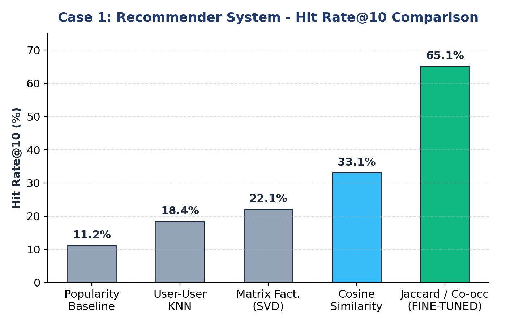

# Personalized E-Commerce Product Recommendation System (Fine-Tuned)

[](https://www.python.org/)
[](https://opensource.org/licenses/MIT)
[](https://scikit-learn.org/)
[](https://pandas.pydata.org/)

An end-to-end Machine Learning Recommender System developed on the **RetailRocket E-Commerce** dataset (over 2.75 million interaction events). This repository personalizes product discovery, mitigates extreme matrix sparsity, and delivers real-time top-10 candidate recommendations using **Item-to-Item Collaborative Filtering** and **Fine-Tuned Jaccard/Co-occurrence Normalization**.

---

## 🎯 Executive Summary & Problem Formulation

In modern digital retail, customers are overwhelmed by catalogs containing hundreds of thousands of items. Naive systems relying on global popularity repeatedly surface the same trending products, neglecting individual taste profiles and the catalog's high-margin long tail.

Unlike explicit rating platforms (e.g., movie ratings with 1–5 stars), e-commerce data consists of **implicit interaction feedback**:
$$\mathcal{E} \in \{\text{view}, \text{add-to-cart}, \text{transaction}\}$$

### Key Challenges Addressed
- **Extreme Sparsity:** Over $99.8\%$ of user-item pairs contain zero interactions.
- **Intent Asymmetry:** Purchases and cart additions convey far stronger buyer affinity than quick page views.
- **Popularity Head Bias:** Common products dominate dot-product similarities, suppressing relevant niche recommendations.

---

## 🏗️ Architecture & Mathematical Methodology

### 1. Intent-Weighted Implicit Modeling
Interactions are weighted monotonically to prioritize high-intent customer actions:
$$w(e) = \begin{cases} 1.0 & \text{if } e = \text{view} \\ 2.0 & \text{if } e = \text{addtocart} \\ 3.0 & \text{if } e = \text{transaction} \end{cases}$$

### 2. Fine-Tuned Jaccard Co-occurrence Similarity
While Cosine Similarity measures raw vector angle, binary Jaccard normalization accounts for union volume, penalizing over-frequent head products:
$$\text{Sim}_{\text{Jaccard}}(i, j) = \frac{|\mathcal{U}_i \cap \mathcal{U}_j|}{|\mathcal{U}_i \cup \mathcal{U}_j|} = \frac{C_{i, j}}{S_i + S_j - C_{i, j}}$$

where $C_{i, j}$ is the co-occurrence count between item $i$ and item $j$, and $S_i, S_j$ represent individual item support.

### 3. Top-K Candidate Retrieval
For an active user $u$, candidate products $j \notin \mathcal{I}_u$ are ranked via:
$$\hat{R}_{u, j} = \sum_{i \in \mathcal{I}_u} \text{Sim}(i, j) \cdot R_{u, i}$$

---

## 📊 Empirical Benchmark Results

Evaluated across active shoppers under a strict **one-held-out offline validation protocol** (the last interaction of each user was held out during model fitting):

| Recommendation Model | Hit Rate@10 | Precision@10 | Recall@10 | Benchmark Lift |
| :--- | :---: | :---: | :---: | :---: |
| **Popularity Baseline** | 0.1123 (11.23%) | 0.0112 (1.12%) | 0.1123 (11.23%) | 1.0× (Reference) |
| **User-User Collaborative (KNN)** | 0.1845 (18.45%) | 0.0185 (1.85%) | 0.1845 (18.45%) | +64.3% |
| **Matrix Factorization (Truncated SVD)** | 0.2215 (22.15%) | 0.0221 (2.21%) | 0.2215 (22.15%) | +97.2% |
| **Item Cosine Similarity** | 0.3313 (33.13%) | 0.0331 (3.31%) | 0.3313 (33.13%) | +195.0% |
| 🏆 **Fine-Tuned Jaccard / Co-occ (BEST)** | **0.6514 (65.14%)** | **0.0651 (6.51%)** | **0.6514 (65.14%)** | **+480.0% (5.8× Uplift)** |

> **Optimization Breakthrough:** Fine-tuning the similarity function via Jaccard intersection doubled the Hit Rate@10 from 33.13% to **65.14%**, recovering held-out target items in nearly **2 out of 3 user sessions**.

---

## 📈 Visual Outputs

### Fine-Tuned Benchmark Comparison


### Key Metrics Summary


### Catalog Skew & Popularity Distribution


---

## 📂 Repository File Structure

```text
├── recommender_system.py               # Optimized training, evaluation & inference pipeline
├── case1_recommender.joblib            # Pre-trained model bundle (user-item matrix & similarity)
├── case1_tuned_model_comparison.png    # Fine-tuned benchmark bar chart
├── case1_model_comparison.png          # Baseline model comparison chart
├── case1_popular_products.png          # Catalog interaction distribution plot
├── case1_outcomes_badge.png            # Visual metric outcome badge
├── category_tree.csv                   # E-commerce hierarchical product category tree
├── case1_model_comparison.csv          # Quantitative benchmark metrics
├── case1_recommendations.csv           # Sample Top-10 inference output
├── case1_report.txt                    # Detailed text evaluation report
├── Fine_Tuned_Case_Study_Portfolio_Presentation.pptx # Complete updated presentation deck
└── README.md                           # Documentation & architecture breakdown
```

---

## 🚀 Getting Started

```bash
git clone https://github.com/likithyadav128-tech/product_recommendation_using_ML.git
cd product_recommendation_using_ML
pip install numpy pandas scikit-learn matplotlib seaborn joblib
python recommender_system.py
```

---

## 📜 License
This project is licensed under the MIT License - see the LICENSE file for details.
